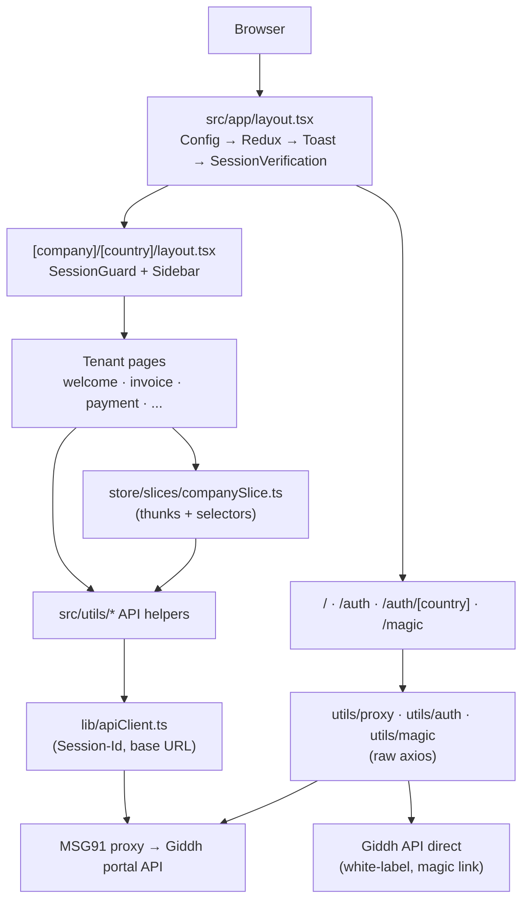

# Architecture & Mental Model

Giddh Portal is a Next.js 16 App Router app (React 19, TypeScript, Tailwind) that behaves as a
client-rendered SPA: every page is a `"use client"` component, global state is one Redux Toolkit slice
persisted to `localStorage` by redux-persist, and all data comes from the Giddh API (mostly through an
MSG91 proxy) via Axios helpers in `src/utils/`. There is no middleware, no server action and no server-side
data fetching; the only server code is the AWS metadata route `src/app/api/instance-metadata/route.ts`.

Endpoints, payloads, cookies and storage contracts: [CONTRACTS.md](CONTRACTS.md). Journeys (login, white-label
resolution, invoice pay, magic link): [FLOWS.md](FLOWS.md). Env vars and build: [DEVELOPMENT.md](DEVELOPMENT.md).

## System Overview & Mental Model



The URL is the tenant key: `[company]` (the business's slug) selects the Redux entry, the session cookie
and the localStorage user record; `[country]` (`uk` vs anything else) selects the API base URL. Example:
`/AcmeTraders/in/invoice`. The `[company]/[country]` prefix is a team rule for every tenant route
(`.windsurf/rules/giddh-portal.md`).

## Entry Points & Bootstrap Sequence

1. **Entry file:** `src/app/layout.tsx:RootLayout` (server component; only mounts client providers). Metadata is `src/app/metadata.ts:metadata`, built from `DEFAULT_CONFIG` (brand and favicon before white-label).
2. **Provider tree, outermost first:**
   - `src/contexts/ConfigContext.tsx:ConfigProvider` — initial state is `localStorage["whiteLabel"]` merged over `DEFAULT_CONFIG`; on mount fetches `${GIDDH_API_URL or GIDDH_API_URL_UK}/white-label` (skipped on `/magic` and `/magic.html`), re-caches it, then sets `isLoading=false`.
   - `src/components/FaviconUpdater.tsx` and `src/components/TitleUpdater.tsx` — siblings of the Redux provider; apply logo and brand once config has loaded.
   - `src/providers/ReduxProvider.tsx:ReduxProvider` — `Provider` + `PersistGate`. paths starting with `/magic` and exactly `/auth` get `loading={null}` (commit `e06d094`, "Redux issue for auth when user is not logged in"); every other path shows `src/components/PersistGateLoading.tsx` until rehydration.
   - `src/contexts/ToastContext.tsx:ToastProvider` — `useToast().showToast(message, type)`.
   - `src/components/SessionVerification.tsx` — listens for the window `session-expired` event and opens `SessionExpiredModal`.
3. **Tenant bootstrap** (`src/app/[company]/[country]/layout.tsx:CompanyLayout`): wraps children in `SessionGuard` → `SidebarProvider` → `LayoutContent`. When a session cookie exists and the path is not login/auth, it resolves `companyUniqueName`/`accountUniqueName` from Redux, else from `getUserDataFromStorage`, and dispatches `fetchCompanyDetails` and `fetchUserDetails` once per company-and-account pair (a `useRef` guard). Pages then dispatch their own page-specific thunks.

> [!WARNING]
> Server HTML is only the PersistGate fallback. `PersistGate` never bootstraps during SSR, so page
> components do not render on the server (inferred from redux-persist's `PersistGate` behaviour). This is
> also why `useSearchParams` works without a `Suspense` boundary in `src/app/auth/page.tsx` and
> `src/app/magic/page.tsx`. Moving a page outside `ReduxProvider`, or turning a page into a server
> component, changes this and can break the build or cause hydration mismatches.

## Major Modules & Responsibilities

| Module / Layer | Path | Core Responsibility | Sources of Truth | May Depend On | Must NOT Depend On |
|---|---|---|---|---|---|
| Routing / Pages | `src/app/` | Route segments, tenant layout, page orchestration (read params, dispatch thunks, call utils) | URL params, query string | store, utils, contexts, hooks, components | `axios` or `src/lib/apiClient.ts` directly (no page does today) |
| Components | `src/components/` | Presentation; a few data-aware widgets (`PayNow`, `Sidebar`, `SwitchAccountButton`, cards) | Props, Redux selectors | store, utils, contexts | Raw axios (none do) |
| Application State | `src/store/` | One slice `companies`, keyed by `[company]`; async thunks; curried selectors | Redux (persisted) | `src/utils/*` fetchers, `src/lib/apiClient.ts`, constants | React components |
| Contexts | `src/contexts/` | White-label config, sidebar collapse, toasts | `localStorage`, component state | `src/config/`, `src/components/ui/` | Redux (`ConfigProvider` sits outside `ReduxProvider`) |
| Hooks | `src/hooks/` | `useAppConfig` (flat view of `useConfig`), `useAmountFormatOptions` (decimals + locale from Redux) | Context / Redux | contexts, store, utils | API calls |
| Server / Remote Data | `src/utils/`, `src/lib/apiClient.ts` | One function per Giddh call; auth/session helpers; magic-link transforms | Remote API | `src/config/`, `src/constants/`, `src/types/` | Components, contexts (only `src/utils/auth/setupUserSession.ts` imports the slice) |
| Config & Constants | `src/config/`, `src/constants/` | Per-environment URLs/ids, white-label merge, API path builders, enums | `NEXT_PUBLIC_APP_ENV`, `localStorage["whiteLabel"]` | nothing app-level | everything else |
| Business Logic | pure files in `src/utils/`, `src/lib/utils.ts` | Currency/number/date formatting, ledger transforms, `mergeClassNames` | Invariants | constants | Framework hooks |

`tsconfig.json` maps the `@/` alias to `src/` and runs `strict`; import with `@/…`, not relative climbs.

### Route tree and guards

`SessionGuard` (`src/components/SessionGuard.tsx`) wraps everything under `[company]/[country]`. It is
client-side only: if the path contains none of `/auth`, `/login`, `/invoice/preview`, `/payment/preview`,
`/invoice-pay` and the `<company>-session` cookie is missing, it `router.push`es to `/<company>/<country>/login`.
Real authorization is the API rejecting the `Session-Id` header.

| Route (file) | What it does | Guard / chrome |
|---|---|---|
| `src/app/page.tsx` (`/`) | Static landing using `config.BRAND_NAME` | Public |
| `src/app/auth/page.tsx` (`/auth`) | Entry for `?proxy_auth_token=&company=&country=` (falls back to `sessionStorage` company/country): `getDetails` → `verifyPortalUser` → one account: `savePortalSession` + `setupUserSession` → `welcome`; several: `sessionManager.setPendingAuth` → `[company]/[country]/auth` | Public; PersistGate `loading={null}` |
| `src/app/auth/[country]/page.tsx` | Same flow, country from the path (target of `src/utils/auth/getAuthRedirectPath.ts:getAuthRedirectPath`) | Public |
| `src/app/magic/page.tsx` (`/magic?id=`) | Standalone ledger viewer for a magic link; `/magic.html` rewrites here (`next.config.ts`) | Public; no Redux use, no white-label fetch |
| `src/app/[company]/[country]/page.tsx` | Redirects to `login` | — |
| `src/app/[company]/[country]/login/page.tsx` | Google or MSG91 OTP sign-in → `verifyPortalUserByAccessToken` → account pick or session | No sidebar |
| `src/app/[company]/[country]/auth/page.tsx` | Account picker for pending auth from `sessionManager` | No sidebar |
| `src/app/[company]/[country]/welcome/page.tsx` | Dashboard: balance summary, user details, last payment | Guarded |
| `src/app/[company]/[country]/invoice/page.tsx` | Invoice list (`fetchAllInvoices`), download, pay | Guarded |
| `src/app/[company]/[country]/invoice/preview/page.tsx` | One invoice (`?voucher=`, or `voucherUniqueName`/`invoice`/`invoiceUniqueName`); a `proxy_auth_token` in the URL is redirected to `/auth` | Public; footer only with a session |
| `src/app/[company]/[country]/payment/page.tsx` | Payment list (`fetchAllPayments`) | Guarded |
| `src/app/[company]/[country]/payment/preview/page.tsx` | One receipt (`?voucher=`) | Public |
| `src/app/[company]/[country]/invoice-pay/account/[accountUniqueName]/voucher/[voucherUniqueName]/page.tsx` | Pay one invoice without logging in (`PayNow`); handles the PayPal `PayerID` return | Public |
| `src/app/[company]/[country]/invoice-pay/[...slug]/page.tsx` | Re-exports the page above so the same URL also matches as a catch-all (commit `5b7cc5b`, "payment link") | Public |
| `src/app/[company]/[country]/account-statement/page.tsx` | Ledger statement with date range and export | Guarded |
| `src/app/[company]/[country]/details/page.tsx` | User/account details from Redux | Guarded |
| `src/app/api/instance-metadata/route.ts` | Every HTTP method returns the EC2 instance identity document via IMDSv2 (3 s timeout) | Public, server |
| `src/app/not-found.tsx` | 404 | — |

Routes are singular (`invoice`, `payment`), not `invoices`/`payments` as older docs said. `next.config.ts`
also redirects `/:company/:country/invoice-preview` → `/:company/:country/invoice/preview` (temporary) and
sets `reactStrictMode: true`. There are no custom headers and no middleware or proxy file.

> [!WARNING]
> The public-route list is duplicated, matched with `includes()`, in `src/components/SessionGuard.tsx`,
> `src/lib/apiClient.ts` (401/403 handling) and `src/app/[company]/[country]/layout.tsx` (sidebar/footer).
> A new public page must be added to all three, and any path that merely *contains* `/auth` or `/login`
> is treated as public.

## Rendering Strategy & Boundaries

- **Rendering pattern:** client-rendered SPA inside the App Router. Server modules are only `src/app/layout.tsx`, `src/app/not-found.tsx`, `src/app/metadata.ts`, the pass-through `src/app/[company]/[country]/invoice-pay/layout.tsx` and the API route.
- **Client vs server boundary:** every `page.tsx`, the tenant layout, all contexts and `ReduxProvider` start with `"use client"`. Browser globals (`window`, `localStorage`, `document.cookie`) are used in effects and in `src/lib/apiClient.ts`; helpers guard with `typeof window === "undefined"`.
- **Loading fallbacks:** no route-level loading or error files and no `Suspense`. Loading is the PersistGate spinner, per-sub-state `loading` flags, and skeletons in `src/components/skeletons/` (see [DESIGN.md](DESIGN.md)).
- **Metadata:** static `metadata` export only; brand title and favicon are swapped on the client by `TitleUpdater`/`FaviconUpdater`.

## Application State Ownership

| State Kind | Owner / Tool | Lifespan | Invalidation / Reset Rule |
|---|---|---|---|
| Server Cache | Redux slice `companies` (`src/store/slices/companySlice.ts:companySlice`), persisted under redux-persist key `companies` with `autoMergeLevel2` (`src/store/store.ts`) | Until logout/switch; survives reloads | Thunk `condition`s skip refetch (`fetchUserDetails` refetches when the account changes; list thunks compare sort/page/`refetch`); `PayNow` dispatches `invalidatePaymentsData`/`invalidateInvoicesData` after paying; `clearCompanyData` on logout and account switch |
| Global UI State | `ConfigContext` (white-label `AppConfig`), `SidebarContext` (collapse, mobile open), `ToastContext` | Tab | Config re-fetched on every full load; sidebar collapse persisted |
| URL State | `[company]`, `[country]`, `[accountUniqueName]`, `[voucherUniqueName]`; query `voucher`, `id`, `proxy_auth_token`, `PayerID`, list page/sort params | Bookmarkable | Lists `router.push` new query strings |
| Session | Cookie `<company>-session` (`src/utils/cookies.ts:setSessionCookie`, 7 days, path `/`) | 7 days | `src/utils/logout.ts:logoutCompany` deletes it |
| Browser storage | `localStorage`: `companies` (persist), `whiteLabel`, `userData:<company>`, `userEmail:<company>` (legacy flat `userData`/`userEmail` read as fallback, then removed), `proxy_auth_token`, `accessToken`, `authProvider`, `portalSidebarCollapsed`. `sessionStorage`: `pendingAccounts`, `pendingToken`, `pendingEmail`, `pendingTokenType`, `companyName`, `country` (`src/utils/sessionManager.ts:sessionManager`) | Varies | Full contract (writers, readers, shapes) lives in [CONTRACTS.md](CONTRACTS.md) |
| Local Form State | `useState` in pages; no form library | Component | Discarded on unmount |

Slice shape (one entry per URL company slug; each feature sub-state is `{ data, loading, error, lastFetchTimestamp? }`):

```typescript
CompanyState = { [companyName: string]: {
  companyName, country, companyDisplayName?, companyUniqueName?,
  user?,                         // fetchCompanyDetails; also derives companyAddress {data, gstin, taxType}
  userData?, account?,           // setUserData / setAccount, from setupUserSession
  balanceSummary?, accountDetails?, accountsList?, allPayments?, allInvoices?,
  userDetails?,                  // fetchUserDetails = account details + contacts
  companyAddress?, vendorsList?, // vendorsList feeds SwitchAccountButton
} }
```

Selectors are curried, `selectX(companyName)(state)`, used as `useAppSelector(selectX(companyName))` with the
typed hooks in `src/store/hooks.ts`. Thunks take `companyName` (URL slug) plus the API identifiers
`companyUniqueName` and `accountUniqueName`; the slug and `companyUniqueName` are different values. Thunks
are grouped in the file as "global" (`fetchCompanyDetails`, `fetchUserDetails`, `fetchAccountDetails`,
called from the layout) and "page-specific" (`fetchBalanceSummary`, `fetchAllInvoices`, `fetchAllPayments`,
`fetchVendorsList`, `fetchAccountsList`).

> [!WARNING]
> Data is per company, but `companies` is one `localStorage` record shared by every tab. Per-company
> `userData:<company>` keys replaced the flat `userData` key in commit `276cff8` ("Fixed multi tab issue");
> do not reintroduce unscoped keys.

## API Access & Contract Flow

```text
page / component
  ├─ dispatch(thunk) ── companySlice ──┐
  └─ utils/<resource>.ts ──────────────┴─> lib/apiClient.ts ─> API_URL | API_URL_UK (MSG91 proxy) ─> Giddh portal API
utils/proxy/*, utils/auth/verifyPortalUserByAccessToken.ts ─> raw axios ─> API_URL | API_URL_UK, PROXY_URL
utils/magic/*  ─> raw axios ─> GIDDH_API_URL (direct)
ConfigContext  ─> fetch ─> GIDDH_API_URL[_UK]/white-label
utils/auth/googleIdentity.ts, utils/auth/msg91OtpWidget.ts ─> third-party scripts
```

- **Client wrapper:** `src/lib/apiClient.ts:apiClient` (one Axios instance, 60 s timeout). Paths come from `src/constants/apiPaths.ts:API_PATHS`; proxy and magic-link paths from `PROXY_API_PATHS` and `GIDDH_MAGIC_LINK_PATHS`.
- **Base URL:** chosen per request from the second path segment (`uk` → `API_URL_UK`, else `API_URL`) using `src/config/default.ts:getConfig`, which re-reads `localStorage["whiteLabel"]` on every call, so white-label overrides apply as soon as `ConfigProvider` caches them.
- **Authentication injection:** the request interceptor reads the `<first path segment>-session` cookie and sends it as `Session-Id`. Proxy/auth helpers send no session; `getDetails` sends `proxy_auth_token` as a header.
- **Error handling:** on 401/403, outside the public routes and when no `proxy_auth_token` is in `localStorage`, it dispatches the window event `session-expired` (shown by `SessionVerification`); the error is still rejected. Pages catch errors locally and show `ErrorMessage` or a toast; thunks store an `error` string in the slice.

> [!WARNING]
> `apiClient` derives company and country from the *current URL*, not from its arguments. Called from
> `/auth` or `/magic` (first segment `auth`/`magic`) it sends no session and uses the non-UK base. Use the
> raw axios helpers there, as the existing code does.

## Business Rules & Logic Placement

- **Form & input validation:** inline in pages; there is no schema or form library in `package.json`.
- **Role & permission checks:** none client-side beyond `src/components/SessionGuard.tsx:SessionGuard` (cookie presence). Which accounts a user may act as comes from `verify-portal-user` and is chosen in `src/app/[company]/[country]/auth/page.tsx`; the server enforces access.
- **Session establishment:** `src/utils/auth/setupUserSession.ts:setupUserSession` is the one place that sets the cookie, Redux `userData`/`account` and the scoped localStorage keys. Login, `/auth`, `/auth/[country]`, the account picker and `SwitchAccountButton` all go through it; `logoutCompany` plus `clearCompanyData` undo it.
- **Domain calculations:** amount formatting `src/utils/currency.ts`, `src/utils/numberFormat.ts`, `src/hooks/useAmountFormatOptions.ts:useAmountFormatOptions`; magic-link ledger shaping `src/utils/magic/getMagicLinkData.ts`, `src/utils/magic/transformLedgerTransaction.ts`, `src/utils/magic/buildFooterSummary.ts`; dates `src/utils/dateUtils.ts`; page size `PAGINATION_LIMIT` in `src/constants/index.ts`.
- **Configuration:** `src/config/default.ts` holds `PROD_CONFIG` and `NON_PROD_CONFIG`; `DEFAULT_CONFIG` is picked by `APP_ENV`/`NEXT_PUBLIC_APP_ENV` (`prod` vs anything else) and `mergeWhiteLabelConfig` overlays the `/white-label` response. Read it in React with `useConfig()`/`useAppConfig()`, outside React with `getConfig()`. Default user-facing copy goes in `PORTAL_MESSAGES`.

> [!WARNING]
> Only `NEXT_PUBLIC_*` vars reach the browser bundle. A build that sets `APP_ENV=prod` without
> `NEXT_PUBLIC_APP_ENV` gives server code (metadata) `PROD_CONFIG` while the browser falls back to
> `NON_PROD_CONFIG` (inferred from Next.js env inlining). Set `NEXT_PUBLIC_APP_ENV`; see [DEVELOPMENT.md](DEVELOPMENT.md).

## External Systems & Dependencies

| External System | Purpose | Communication Contract | Location in Code |
|---|---|---|---|
| Giddh portal API via MSG91 proxy (`API_URL`, `API_URL_UK`) | Company, account, invoices, payments, statements, pay requests, verify user, save session | [CONTRACTS.md](CONTRACTS.md) | `src/lib/apiClient.ts`, `src/utils/*.ts`, `src/utils/proxy/`, `src/utils/auth/verifyPortalUserByAccessToken.ts` |
| Giddh API direct (`GIDDH_API_URL`, `GIDDH_API_URL_UK`) | White-label config, magic-link ledger and voucher download | [CONTRACTS.md](CONTRACTS.md) | `src/contexts/ConfigContext.tsx`, `src/utils/magic/` |
| MSG91 proxy (`PROXY_URL`) | Resolve a `proxy_auth_token` to the user's details | `PROXY_API_PATHS.GET_DETAILS` | `src/utils/proxy/getDetails.ts` |
| MSG91 OTP widget and proxy-auth script | OTP login; proxy auth on public preview/pay pages | Injected scripts | `src/utils/auth/msg91OtpWidget.ts`, `src/app/[company]/[country]/invoice/preview/page.tsx` |
| Google Identity Services | Google sign-in | OAuth access token, then userinfo | `src/utils/auth/googleIdentity.ts` |
| Razorpay, PayPal, PayU | Paying invoices | Checkout script / form POST | `src/components/PayNow.tsx` |
| AWS EC2 IMDSv2 | Instance identity for ops | `GET /api/instance-metadata` | `src/app/api/instance-metadata/route.ts` |

There is no analytics or error-reporting SDK in `package.json`; `src/utils/logger.ts` logs only when `NODE_ENV` is `development`.

## Layer Rules

1. Pages and components never import `axios` or `src/lib/apiClient.ts`; add a function in `src/utils/` (or a thunk) and call that.
2. Only `src/utils/*` and `src/store/slices/companySlice.ts` talk HTTP. `apiClient` is for tenant pages; raw axios with a base from `getConfig()` is for flows without a tenant URL or session (`src/utils/proxy/`, `src/utils/auth/`, `src/utils/magic/`).
3. Build URLs with `src/constants/apiPaths.ts`, never inline strings.
4. Read config through `useConfig`/`useAppConfig` in React and `getConfig()` elsewhere; never hardcode a URL or brand. (`src/components/PayNow.tsx` hardcodes the production PayPal URL today and ignores `PAYPAL_URL`.)
5. Contexts must not depend on Redux; `ConfigProvider` mounts before the store.
6. Every Redux read or write is keyed by the URL `[company]` slug; never put tenant data at the slice root.
7. Session changes go through `setupUserSession` and `logoutCompany` so the cookie, Redux and localStorage stay in step.

## Where New Code Goes

| Adding | Put it in | Also touch |
|---|---|---|
| A tenant page | `src/app/[company]/[country]/<route>/page.tsx` with `"use client"`, reading `useParams()` | Nav items in `src/components/Sidebar.tsx`; if it is public: `publicRoutes` in `src/components/SessionGuard.tsx` and `src/lib/apiClient.ts`, `guestRoutes` in `Sidebar.tsx`, and the footer checks in `src/app/[company]/[country]/layout.tsx` |
| A page outside a tenant | `src/app/<route>/page.tsx` | `src/providers/ReduxProvider.tsx` if it should skip the "Loading your data" gate |
| An API call | `src/utils/<resource>.ts` using `apiClient`, plus a builder in `src/constants/apiPaths.ts` | Endpoint row in [CONTRACTS.md](CONTRACTS.md) |
| Cached shared data | A thunk, sub-state and curried selectors in `src/store/slices/companySlice.ts` | A `condition` to avoid refetch; an invalidate reducer if a mutation changes it |
| A new slice | `src/store/slices/`, registered in `src/store/store.ts` (wrap in `persistReducer` only if it must survive reload) | `RootState` in `src/store/store.ts` is hand-written; extend it |
| A white-label or config value | `AppConfig` and both env objects in `src/config/default.ts`, mapping in `mergeWhiteLabelConfig` | `src/hooks/useAppConfig.ts` if pages need a shortcut |
| A constant or enum | `src/constants/<topic>.ts`, re-exported from `src/constants/index.ts` | — |
| A UI primitive | `src/components/ui/` | [DESIGN.md](DESIGN.md) |
