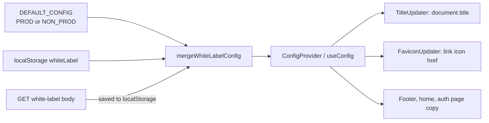

# Design System & UI Standards

The portal is what a Giddh customer's own customers see: invoices, payments, a statement, a pay button
(confirmed by the owner, 2026-11-17). It is styled with **Tailwind CSS 3** utility classes only, with a
small set of hand-written primitives in `src/components/ui/` (shadcn-style: `class-variance-authority` +
`src/lib/utils.ts:mergeClassNames`, which is `clsx` + `tailwind-merge`). Interactive menus use
`@headlessui/react` (only in `src/components/Dropdown.tsx`). Icons come from `@heroicons/react` (most
places) and `lucide-react` (a few: `Menu`, sort arrows, `X`, `Users`). There is no design-token package,
no dark mode in use and no Storybook.

This doc absorbs `docs/DATE_RANGE_CALENDAR.md` and the branding half of `docs/WHITELABEL_CONFIG.md`;
where those disagree with the code, the code (as described here) wins.

## Visual & Interaction Principles

Observed in the code, not written down anywhere else:

1. **Quiet, Tailwind-UI look.** White cards on `bg-gray-50`, `shadow-sm`, `sm:rounded-lg`, gray text scale
   (`text-gray-900` headings, `text-gray-500/600` secondary). Comments in `src/components/ui/card.tsx` and
   `src/components/ui/DataTable.tsx` name the Tailwind UI templates they copy.
2. **One accent colour: navy `blue-900`.** Active nav items, links, pagination current page, the date
   calendar's selected days and Apply button, the guest-page auth header all use `blue-900`
   (= `giddh-primary`, `#1e3a8a`). Secondary actions use `blue-50`/`blue-600` (`Button` `default` variant).
3. **Skeletons for data, spinners for navigation.** Lists and dashboard cards show a pulse skeleton
   (`src/components/skeletons/`) while their Redux slice is loading; full-page transitions (auth, redirects,
   persist rehydration) show `LoadingSpinner` / `PersistGateLoading`.
4. **Inline states, not pages.** Each list renders loading → error → empty → data in place
   (see the ternary in `src/app/[company]/[country]/payment/page.tsx:PaymentsPage`). Transient outcomes go
   to a toast (`src/contexts/ToastContext.tsx:useToast`).
5. **Draft-then-apply filters.** The date range calendar keeps a temporary selection and only calls back on
   Apply, so the list refetches once per change.

## Design Tokens & Styling Primitives

- **Token Source Files:** `tailwind.config.ts` (theme extension) and `src/app/globals.scss` (CSS variables
  under `:root`). PostCSS runs `tailwindcss` + `autoprefixer` (`postcss.config.js`). Tailwind `content`
  scans `src/**` TS/TSX files (plus three globs outside `src/` that match nothing).
- **Colors:**
  - Brand: `giddh-primary` (`#1e3a8a`) and `giddh-primary-light` (`#3b82f6`) in `tailwind.config.ts`.
    In practice most code writes `blue-900` / `blue-600` directly (about 70 `text-blue-*`/`bg-blue-*`
    uses vs 6 `giddh-primary` uses, all in `src/app/[company]/[country]/auth/page.tsx`,
    `src/components/ErrorMessage.tsx`, `src/components/LoadingSpinner.tsx`, `src/components/LastPaymentCard.tsx`).
  - shadcn semantic tokens: `background`, `foreground`, `primary`, `secondary`, `destructive`, `muted`,
    `accent`, `popover`, `card` (each with `-foreground`), `border`, `input`, `ring`, all
    `hsl(var(--name))`. Only `bg-background`, `text-foreground` (on `body`) and `border-border` (on `*`)
    are used; components use raw palette colours instead.
  - Feedback: success `green-50/400/800`, error `red-50/600` (+ `ring-red-200`), info `yellow-50/400/800`
    (see `toastStyles` in `src/contexts/ToastContext.tsx`). There is no warning token.
- **Typography:** no custom font; the Tailwind default sans stack (no `next/font`). Scale in use: page
  title `text-xl font-semibold` in the page header; card title `text-lg font-semibold`
  (`src/components/ui/card.tsx:CardTitle`); body `text-sm`; caption `text-xs text-gray-500`.
- **Radius:** `--radius: 0.5rem` drives `rounded-lg/md/sm`. Most surfaces use `rounded-md` / `sm:rounded-lg`.
- **Spacing & Elevation:** page header `px-6 py-4 border-b bg-white`; page body `p-6` with
  `mx-auto max-w-7xl` (lists) or `max-w-5xl` (welcome); cards `p-4`; shadows `shadow-sm` (cards, tables),
  `shadow-lg` (popovers), `shadow-xl` (modals).
- **Animations:** `accordion-down/up` (unused) and `slide-in-right` keyframes in `tailwind.config.ts`.
- **Container:** centred, `padding: 2rem`, `2xl: 1400px`.
- **Dark Mode:** `darkMode: ["class"]` is configured but nothing sets a `dark` class and no `dark:`
  utilities exist. The app is light-only. `LogoConfig.light`/`dark` exist in `src/config/default.ts` but
  are never read.

### The "Tailwind only" rule and its existing violations

`.windsurf/rules/giddh-portal.md` (always on): Tailwind utilities only; no custom CSS/SCSS files, no CSS
Modules, no inline style tags. New code must follow it. The code at `88f8405` already breaks it in these
places (recorded, not fixed):

| Where | What | Why it exists (inferred) |
|---|---|---|
| `src/app/globals.scss` | The global stylesheet is SCSS (`sass` is a devDependency). Lines after the Tailwind layers define `.auth-container` and `.auth-header-preview` with nested selectors, media queries and `!important` | Styles the MSG91 proxy auth widget, which injects its own DOM into `<div id={referenceId} className="auth-container">` on `invoice/preview`, `payment/preview` and `invoice-pay/.../voucher/...` pages; Tailwind classes cannot reach injected markup |
| `src/app/[company]/[country]/layout.tsx:LayoutContent` | an inline `style` setting `willChange: "margin-left"` on `<main>` | Smooth sidebar collapse; `will-change-[margin-left]` would do the same |
| `src/components/ui/DateRangeCalendar.tsx` | an inline `style` setting `left`, `width`, `top`/`bottom` on the portal | Position is computed from `getBoundingClientRect` at runtime |
| `src/components/magic/SearchAndViewControls.tsx` | `style` sets `--segment-count`, `--selected-index` and a `transform` | Animated segmented currency toggle |
| `src/components/PayNow.tsx` | an inline `style` setting `display: "none"` on the PayPal form | Use `className="hidden"` |
| `src/app/[company]/[country]/login/page.tsx` | `border-[#000]` arbitrary hex on both login buttons | — |

Runtime-computed positions are a reasonable exception; say so in the PR when adding one.

## White-label branding at runtime

Brand values live in `AppConfig` (`src/config/default.ts`): `BRAND_NAME`, `LOGOS` (`LogoConfig`:
`primary`, `light`, `dark`, `icon`, `favicon`), `WEBSITE_DOMAIN`, and the copy string
`SWITCH_ACCOUNT_AUTH_ERROR_MESSAGE`. Colours are **not** white-labelled.



- `src/contexts/ConfigContext.tsx:ConfigProvider` (mounted first in `src/app/layout.tsx`) starts from the
  cached `whiteLabel` entry, then fetches the white-label endpoint (skipped on `/magic`), caches it and
  merges. The fetch, its base URL per country and the storage key are documented in
  [CONTRACTS](CONTRACTS.md); the resolution journey is in [FLOWS](FLOWS.md).
- `mergeWhiteLabelConfig`: `brandName` → `BRAND_NAME`, `logos` → `LOGOS` (whole object, not per key),
  `portalMessages.switchAccountAuthError` → `SWITCH_ACCOUNT_AUTH_ERROR_MESSAGE`; each falls back to the default.
- Read branding with `useConfig()` (`src/contexts/ConfigContext.tsx:useConfig`) or
  `src/hooks/useAppConfig.ts:useAppConfig`. `src/config/default.ts:getConfig` is the non-React variant.
- Where brand shows today: `document.title` = `` `${BRAND_NAME} Portal` `` (`src/components/TitleUpdater.tsx`);
  favicon links (`src/components/FaviconUpdater.tsx`); footer logo `LOGOS.primary` and copyright
  (`src/components/Footer.tsx:Footer`); copy in `src/app/page.tsx` and `src/app/[company]/[country]/auth/page.tsx`.
- Default assets: `public/icons/giddh_text_icon.svg` (`LOGOS.primary`), `public/icons/giddh_app_icon.svg`
  (`LOGOS.favicon`). The defaults `LOGOS.light`, `dark`, `icon` name files that do not exist in `public/`.

> [!WARNING]
> Branding is client-side only. Server HTML always carries the default title and favicon from
> `src/app/metadata.ts`; the white-labelled ones replace them after hydration and after the fetch
> (`isLoading` false), so a white-label customer briefly sees "Giddh Portal" and the Giddh icon.
> `FaviconUpdater` only rewrites `<link>` tags that already exist.

> [!WARNING]
> Not brand-aware yet: `supportEmail="support@giddh.com"` is hard-coded in
> `src/app/[company]/[country]/layout.tsx`, and the colour palette is fixed. Add new user-facing default
> strings to `PORTAL_MESSAGES` in `src/config/default.ts` (its comment asks for this) so a white-label can override them.

Stale claims in `docs/WHITELABEL_CONFIG.md`: there is no `disableWhiteLabel` flag, no <!-- verify:ignore -->
`src/services/whitelabel.ts`, no 10-second timeout and no `WHITELABEL_API_URL`; the fetch always runs. <!-- verify:ignore -->

## Reusable Component Catalog

Import from the file directly (`@/components/...`; the `@/` alias maps to `src/`). The barrels
`src/components/ui/index.ts` and `src/components/magic/index.ts` exist, but only `src/app/magic/page.tsx`
imports a barrel. "Used by" counts files that import it; components used once are listed separately below.

| Component | File Path | Purpose & When to Use | Key Props / Variants |
|---|---|---|---|
| `Button` | `src/components/ui/button.tsx` | Every button and button-like link (14 files) | `variant="default \| outline \| ghost \| destructive \| link"`, `size="xs \| sm \| md \| lg \| xl \| icon"`, `asChild` (Radix `Slot`); has `focus-visible:ring-blue-500` |
| `Card` + `CardHeader/Title/Description/Content/Footer` | `src/components/ui/card.tsx` | Content panels and their skeletons (9 files: welcome cards, details, statement, invoice preview) | `className`; base `bg-white p-4 shadow-sm sm:rounded-lg` |
| `DataTable` | `src/components/ui/DataTable.tsx` (re-exported by `src/components/DataTable.tsx`) | All tables: invoice, payment, statement lists and magic-link tables | `columns: Column<T>[]` (`header`, `accessor` key or `(row, i) => node`, `headerClassName`, `cellClassName`), `data`, `keyExtractor` (required with `data`), optional `title`/`description`/`action`, or `children` for a custom `<table>` body |
| `TableSkeleton` | `src/components/skeletons/TableSkeleton.tsx` | Loading state of the three list pages | `rows` (default 5) |
| `Pagination` | `src/components/Pagination.tsx` | Below every list (3 pages + `src/components/magic/LedgerTable.tsx`) | `currentPage`, `totalPages`, `totalItems`, `itemsPerPage`, `onPageChange` |
| `Dropdown` / `Dropdown.Item` | `src/components/Dropdown.tsx` | Sort / filter / export menus (headless UI `Menu`) on the three list pages | `trigger`, `align`, `fullWidth`, `disabled`, `buttonClassName`, `panelClassName`; item: `href`, `as`, button attrs |
| `DateRangeCalendar` | `src/components/ui/DateRangeCalendar.tsx` | Date filters: account statement and magic-link header | see [below](#date-range-calendar) |
| `SidebarToggleButton` | `src/components/SidebarToggleButton.tsx` | Hamburger in every signed-in page header (7 pages); `md:hidden` | `className` |
| `SwitchAccountButton` | `src/components/SwitchAccountButton.tsx` | Right side of the page header (5 pages) | none |
| `PayNow` | `src/components/PayNow.tsx` | Pay button + gateway hand-off (invoice list, invoice preview, invoice-pay voucher) | `invoiceUniqueName`, `amount`, `currency`, `variant="button \| link"`, `buttonVariant`, `invoicePayMode` + `paymentDetails` + `selectedPaymentMethod`, `autoTrigger`, `companyUniqueName`/`accountUniqueName` overrides for guest pages |
| `LoadingSpinner` | `src/components/LoadingSpinner.tsx` | Auth pages, magic page, switch account (6 files) | `message`, `size="sm \| md \| lg"`, `variant="default \| brand"`, `fullScreen` (default true) |
| `ErrorMessage` | `src/components/ErrorMessage.tsx` | Login/auth errors, magic page, switch account (4 files) | `message`, `variant="inline \| page"`, `onRetry` (page variant only) |
| `useToast().showToast` | `src/contexts/ToastContext.tsx` | Transient success/error/info (10 files) | `showToast(message, type?)`, auto-dismiss 4 s |
| `Input`, `InputGroup` | `src/components/ui/input.tsx` | Text input with optional leading icon | `InputGroup icon`; only used by `src/components/magic/SearchAndViewControls.tsx` so far, but it is the intended primitive |

Used once (layout or single-page pieces; reuse before cloning): `src/components/Sidebar.tsx:Sidebar`,
`src/components/Footer.tsx:Footer` (`variant="full"`; `minimal` unused), `src/components/SessionGuard.tsx`,
`src/components/SessionVerification.tsx`, `src/components/SessionExpiredModal.tsx`,
`src/components/TitleUpdater.tsx`, `src/components/FaviconUpdater.tsx`, `src/components/PersistGateLoading.tsx`,
the welcome cards (`BalanceSummaryCard`, `LastPaymentCard`, `UserDetailsCard`) with their skeletons
(`BalanceSummarySkeleton`, `PaymentCardSkeleton`, `UserDetailsSkeleton`), and the magic-link set in
`src/components/magic/` (`Header`, `Footer`, `LedgerTable`, `StatementViewTable`, `TAccountViewTable`,
`SearchAndViewControls`, `MagicTopControls`, `MagicPagination`, `currencyUtils.ts`), all used only by
`src/app/magic/page.tsx`. `src/components/skeletons/CardSkeleton.tsx` is unused.

There is **no shared Modal**. The two modals (`src/components/SessionExpiredModal.tsx`, the PayU details
form in `src/components/PayNow.tsx`) are hand-rolled `fixed inset-0 z-50 bg-black/50` overlays.

### Date range calendar

`src/components/ui/DateRangeCalendar.tsx:DateRangeCalendar` (it moved from `src/components/magic/`; the old
doc's path is stale). Built on `date-fns`, icons from `@heroicons/react/20/solid`.

- Props (`DateRangeCalendarProps`): `fromDate`, `toDate`, `onFromDateChange`, `onToDateChange` (required);
  `showQuickActions` (default true) or custom `quickActions: {label, getDates}[]`; `dateFormat.{desktop,mobile}`;
  `renderButton` for a custom trigger; `minDate`/`maxDate`; `position="left|right|center"` (default right);
  `openDirection="top|bottom|auto"` (default auto: the side with more room); `compact`.
- Behaviour: the popover is portalled to `document.body` (`fixed z-[9999]`, width `min(320px, 100vw-16px)`,
  repositioned on scroll/resize, clamped to the viewport). Clicks set a temporary from → to; a "to" before
  "from" (or a "from" after "to") collapses both to that day. Apply is disabled until both are set and only
  then calls both callbacks. Clicking outside closes and discards the draft.
- Default quick actions: Last 7 days, Last 30 days, This month, Last 6 months, Last 1 year (they set the
  draft; Apply is still needed).
- Trigger label: `dd MMM yyyy - dd MMM yyyy` on both widths unless `dateFormat` is passed (the old doc's
  `dd/MM` mobile default is no longer true). Callers turn dates into `dd-MM-yyyy` for the API with
  `src/utils/dateUtils.ts:formatDateToAPI` (`src/app/magic/page.tsx`).
- Usage: `src/components/magic/header.tsx` (`position="left"`) and
  `src/app/[company]/[country]/account-statement/page.tsx` (`position="left" compact`).
- Dead props/vars: `calendarWidth` is accepted but ignored; `positionClasses`/`directionClass` are computed and unused.

## Responsive Behavior & Breakpoints

- **Breakpoints:** Tailwind defaults (`sm` 640, `md` 768, `lg` 1024, `xl` 1280, `2xl` 1536; container
  `2xl` capped at 1400). The key breakpoint is **`md`**: below it the sidebar becomes a drawer.
- **Sidebar** (`src/components/Sidebar.tsx`, state in `src/contexts/SidebarContext.tsx:useSidebar`):
  - `md+`: fixed left rail, `w-64`, collapsible to `w-20` (icons only, `title` tooltips). Collapse state
    persists in `localStorage` key `portalSidebarCollapsed`. `<main>` shifts with `md:ml-64` / `md:ml-20`
    (`src/app/[company]/[country]/layout.tsx`).
  - `< md`: off-canvas (`-translate-x-full`), opened by `SidebarToggleButton` in the page header, with a
    `bg-black/40` backdrop; any nav click or the backdrop closes it.
  - Hidden entirely on `/login` and `/auth` routes; on guest routes (`invoice/preview`, `payment/preview`,
    `invoice-pay`) without a session the user block and footer are dropped.
- **Tables** scroll horizontally inside `DataTable` (`overflow-x-auto`, negative margins to bleed to the edge).
- **Pagination** shows only Previous/Next below `sm`, numbered pages from `sm`.
- **Headers** stack filters `flex-col` then `sm:flex-row`; text sizes step `text-xs sm:text-sm`.

## Accessibility (A11y) Standards

Observed good patterns to copy: `aria-hidden` on decorative icons; `aria-label` on icon-only buttons
(sidebar collapse/close/logout, calendar month arrows, toast dismiss); `aria-current="page"` and
`aria-label="Pagination"` in `Pagination`; toasts in an `aria-live="polite"` region with `role="alert"`;
calendar days carry `aria-label` ("From date: …") and `<time dateTime>`; `Button` has a visible
`focus-visible` ring; `<html lang="en">`.

Gaps (record, don't silently copy):

- `SidebarToggleButton` sets `aria-controls="app-sidebar"`, but no element has that id.
- Active nav links have no `aria-current` (`src/components/Sidebar.tsx`).
- Modals have no `role="dialog"`, `aria-modal`, focus trap or Escape handling; the calendar popover also
  ignores Escape and keyboard date navigation.
- Form labels in the PayU modal and the payment sort filter are not tied to inputs (`htmlFor`/`id`).
- Heading levels: `src/app/[company]/[country]/details/page.tsx` has two `<h1>`; preview, invoice-pay
  and magic pages have none.
- Brand colour contrast is fine (`blue-900` on white), but there is no documented contrast check.

## Website Messaging & Copy Guidelines

- **Voice:** short, plain, Title Case labels ("Payments Made", "Account Statement", "Switch Account",
  "Clear Filters", "Re-login"); sentence-case helper text ("Welcome back! Please enter your details.").
- **Errors:** prefer the API's `message`, else a fixed fallback ending in "Please try again."
  (`src/app/[company]/[country]/login/page.tsx`). Inline errors via `ErrorMessage`; list errors as red centred text.
- **Empty states:** one gray centred line: "No payments found", "No user details available"; `DataTable`'s
  own fallback is "No data available". No illustrations.
- **Loading copy:** "Loading...", "Redirecting...", "Processing...", "Signing in...".
- **Brand name:** never hard-code "Giddh" in new copy; use `config.BRAND_NAME`.
- **Money:** always `src/utils/currency.ts:formatCurrencyAmount(amount, symbolOrCurrency, options)`, with
  `options` from `src/hooks/useAmountFormatOptions.ts:useAmountFormatOptions(companyName)` (company's
  decimal places + locale mapped from `balanceDisplayFormat` via `NUMBER_FORMAT_LOCALE_MAP` in
  `src/constants/numberFormat.ts`; default `en-IN`). Output is `"<symbol> <number>"` via `Intl.NumberFormat`
  (`src/utils/numberFormat.ts:formatNumber`). Magic-link pages use `src/components/magic/currencyUtils.ts`.
- **Dates:** `date-fns` only (no dayjs/moment). The API format is `dd-MM-yyyy`:
  `src/utils/dateUtils.ts:formatDateToAPI`, `parseDateFromAPI`, `parseTransactionDate`,
  `formatDateDisplay` (also `dd-MM-yyyy`). Lists show the API's date string as returned.

## SEO & Metadata Expectations

The portal is a signed-in / link-only app; SEO is minimal by design (inferred).

- **Document Titles:** one title for every page: `` `${BRAND_NAME} Portal` `` (static default in
  `src/app/metadata.ts`, white-labelled client-side by `TitleUpdater`). No per-page titles and no
  per-route metadata function anywhere; almost every page is `"use client"`, so per-page `metadata` exports would
  need a server wrapper.
- **Meta description:** `src/app/metadata.ts` still carries scaffold text ("Modern Next.js application with
  TypeScript, TailwindCSS, Redux, and SASS").
- **Favicons:** `icons.icon/shortcut/apple` all `DEFAULT_CONFIG.LOGOS.favicon`; swapped per white-label by `FaviconUpdater`.
- **Robots / sitemap / OpenGraph / canonical:** none: no robots.txt, sitemap, manifest or openGraph metadata.

> [!TODO]
> Whether invoice/statement pages should be explicitly `noindex` (they are reachable by link without a
> session) is a product decision not expressed in the code. Needs a human.

## Recipes

### New page under `[company]/[country]`

Copy the shape of `src/app/[company]/[country]/payment/page.tsx`:

1. Create `src/app/[company]/[country]/<route>/page.tsx` with `"use client"`. The layout
   (`src/app/[company]/[country]/layout.tsx`) already gives you `SessionGuard`, the sidebar, `<main>`
   offset and footer; do not add your own.
2. Read `company`/`country` with `useParams()`; get unique names via
   `src/utils/getUserDataFromStorage.ts:getCompanyAndAccountNames` and Redux selectors (see [ARCHITECTURE](ARCHITECTURE.md)).
3. Header: `<header className="border-b bg-white px-6 py-4">` with `SidebarToggleButton`, one
   `<h1 className="text-xl font-semibold">`, and `SwitchAccountButton` on the right.
4. Body: `<div className="flex-1 p-6"><div className="mx-auto max-w-7xl">…`.
5. If it belongs in navigation, add `{ name, path, icon }` to `navItems` in `src/components/Sidebar.tsx`
   (heroicons 24/outline). Guest (no-session) pages must be added to `guestRoutes` in `Sidebar.tsx` and to
   `isNoSessionFooterRoute` in `layout.tsx` (see [FLOWS](FLOWS.md)).

### New list with skeleton

```tsx
{loading ? (
  <TableSkeleton rows={10} />
) : error ? (
  <div className="py-12 text-center text-red-500">{error}</div>
) : rows.length === 0 ? (
  <div className="py-12 text-center text-gray-500">No payments found</div>
) : (
  <DataTable columns={columns} data={rows} keyExtractor={(row) => row.id} />
)}
{!loading && !error && totalItems > PAGINATION_LIMIT && (
  <Pagination currentPage={page} totalPages={totalPages} totalItems={totalItems}
    itemsPerPage={PAGINATION_LIMIT} onPageChange={setPage} />
)}
```

Build `columns` in `useMemo`; format money in the row mapping with `formatCurrencyAmount` +
`useAmountFormatOptions`; use `Button variant="link" size="sm"` for the clickable id cell; reset to page 1
on every sort/filter change. `PAGINATION_LIMIT` (50) is in `src/constants/index.ts`. For a card, return
a matching skeleton built from `Card` + `animate-pulse` blocks (see `src/components/skeletons/UserDetailsSkeleton.tsx`).

### New modal

No primitive exists; follow `src/components/SessionExpiredModal.tsx`: a component taking `isOpen` /
`onClose`, returning `null` when closed, with
`fixed inset-0 z-50 flex items-center justify-center bg-black/50` → `w-full max-w-md rounded-lg bg-white p-6 shadow-xl`,
an `<h2>`, and `Button size="lg"` actions. Add what the existing ones lack: `role="dialog"`,
`aria-modal="true"`, `aria-labelledby`, Escape to close, and focus on open. If a second new modal is
needed, extract `src/components/ui/` primitive instead of a third copy. Toast stack sits at `z-[100]`
and the calendar at `z-[9999]`, both above modals.

## Gotchas

> [!WARNING]
> `Pagination` with more than 7 pages always renders `1 2 3 … n-2 n-1 n`
> (`getPageNumbers` in `src/components/Pagination.tsx`): middle pages can only be reached with Next/Previous,
> and the current page is not highlighted while in the middle.

> [!WARNING]
> `DataTable` calls `keyExtractor!` without a check; passing `data` without `keyExtractor` crashes.

- Invalid classes that silently do nothing: `text-md` (`src/components/Footer.tsx`), `hover:bg-gray-50-0`
  (`src/components/Pagination.tsx`), `sm:left-[-10]` (unused `positionClasses` in the calendar).
- `src/app/[company]/[country]/invoice-pay/account/[accountUniqueName]/voucher/[voucherUniqueName]/page.tsx`
  references `/images/note.svg`, which is not in `public/`.
- Login button icons load from an external S3 bucket (`src/app/[company]/[country]/login/page.tsx`), not `public/`.
- `prettier-plugin-tailwindcss` (`.prettierrc`) reorders class lists on format; don't hand-sort.
