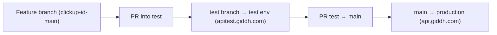

# Development & Verification Guide

Every command below was run on 2026-11-17 against a copy of the tree at `88f8405` (Node v24.18.0, npm 12.0.1, macOS). Results, timings and the exact errors are quoted as observed. This doc replaces `docs/Environment-Setup.md` and the env/deploy parts of `docs/WHITELABEL_CONFIG.md`.

## Prerequisites & Runtime Environment

- **Node.js:** `>=20` (`package.json` `engines`). No `.nvmrc` (removed in `1b4cce3`). Verified on Node 24; the old CodePipeline buildspec quoted in `docs/WHITELABEL_CONFIG.md` also pins `nodejs: 24`.
- **Package manager:** npm. `package-lock.json` is committed; use `npm ci`.
- **Branch:** work from `test` (or `main`). `master` is the legacy Angular 16 portal, frozen at `bc54108` (2026-01-12): never base work on it (confirmed by the owner, 2026-11-17). See [DECISIONS](DECISIONS.md#adr-001-rewrite-the-portal-in-nextjs-on-a-separate-line-from-master).
- **Backend:** none to run locally. The app talks straight to Giddh's hosted APIs (test or prod, chosen below). No Docker, no database.

## Step-by-Step Setup

1. **Install** (17 s on a warm cache; 480 packages):
   ```bash
   npm ci
   ```
   Expected noise: `prepare` prints `skip husky in CI`, `npm audit` reports 22 vulnerabilities (1 low, 6 moderate, 14 high, 1 critical), and npm 12 warns that install scripts for `@parcel/watcher`, `fsevents`, `sharp`, `unrs-resolver` were blocked. The build and dev server work despite the blocked scripts.
2. **Environment:** optional for local work. With no env file the app already uses the non-production config.
   ```bash
   cp .env.example .env.local   # NEXT_PUBLIC_APP_ENV=local
   ```
3. **Dev server** (port is fixed in the script):
   ```bash
   npm run dev                  # next dev -p 8008 (Turbopack), "Ready in 366ms"
   ```
   Open `http://localhost:8008/<company>/<country>/login`, e.g. `/giddh/in/login`. `<company>` is a Giddh company unique name; `<country>` is `in` or `uk` (`uk` switches to the UK API hosts). Route tree: [ARCHITECTURE](ARCHITECTURE.md).

Observed `npm run dev` responses (no env file, no login):

| Request | Status | Note |
|---|---|---|
| `GET /` | 200 | first compile 1.4 s |
| `GET /giddh/in/login` | 200 | |
| `GET /giddh/in` | 200 | renders; session handling is client-side |
| `GET /magic.html` | 200 | rewritten to `/magic` (`next.config.ts`) |
| `GET /giddh/in/invoice-preview` | 307 | redirects to `/giddh/in/invoice/preview` (`next.config.ts`) |
| `GET /auth` | 200 | |
| `GET /api/instance-metadata` | 503 / 504 | expected off AWS: it calls the EC2 metadata service (`src/app/api/instance-metadata/route.ts`) |

The dev log also prints `redux-persist failed to create sync storage. falling back to noop storage.` on every server render. It is harmless: the store is persisted to `localStorage`, which only exists in the browser (`src/store/store.ts`).

## Environment Variables Reference

Only three variables are read anywhere in `src/`. All other configuration (API hosts, MSG91 proxy ids, PayPal URL, Google client id, OTP widget id/token, logos) is hard-coded in `src/config/default.ts` as two objects, `PROD_CONFIG` and `NON_PROD_CONFIG`, and then overridden at runtime by the white-label API (see [Config selection](#how-the-build-picks-prod-vs-non-prod)).

| Variable Name | Required | Client-Exposed | Default Value | Description / Where Read |
|---|---|---|---|---|
| `NEXT_PUBLIC_APP_ENV` | Yes for production builds | Yes (inlined into the bundle at **build** time) | unset → `local` | `prod` selects `PROD_CONFIG`; anything else (`local`, `test`) selects `NON_PROD_CONFIG` (`src/config/default.ts:DEFAULT_CONFIG`) |
| `APP_ENV` | No | **No** (server only) | unset | Checked before `NEXT_PUBLIC_APP_ENV` in the same expression. Does not reach the browser: see warning below |
| `NODE_ENV` | Set by Next | Yes (Next inlines it) | `development` in dev, `production` in build | `src/utils/logger.ts:logger` prints only when `development`; production builds log nothing |

Env files: `.env.example` is the only committed one. `.gitignore` ignores `.env`, `.env.local`, `.env.production`, `.env.test`, `.env.development`. A committed `.env.production` existed from `a241525` (2026-01-30) to `1cc3973` (2026-02-04), and a committed `.env.prod` was added and reverted the same day (`f1197e9` / `db727db`, 2026-03-10). Do not commit env files. <!-- verify:ignore -->

> [!WARNING]
> **`APP_ENV=prod` alone gives a split-brain build.** The selector is `process.env.APP_ENV || process.env.NEXT_PUBLIC_APP_ENV || "local"`. Only `NEXT_PUBLIC_*` is inlined into client code. Built with `APP_ENV=prod` only, the client chunk still contains `env.APP_ENV||env.NEXT_PUBLIC_APP_ENV||"local"`, which evaluates to `local` in the browser: server render uses production hosts, the browser uses `apitest.giddh.com`. Built with `NEXT_PUBLIC_APP_ENV=prod`, the chunk becomes `env.APP_ENV||"prod"`. Both were verified by building the copy and grepping `.next/static/chunks`. Always set `NEXT_PUBLIC_APP_ENV` at build time. Setting it only at `next start` time has no effect on the browser.

> [!WARNING]
> Everything in `src/config/default.ts` ships to the browser (it is imported by client components). That includes `OTP_WIDGET_TOKEN`, `GOOGLE_CLIENT_ID` and the MSG91 `REFERENCE_ID` values. They are meant to be public client identifiers, but never add a real secret to this file or to any `NEXT_PUBLIC_*` variable.

### How the build picks prod vs non-prod

1. **Build time:** `NEXT_PUBLIC_APP_ENV` picks `PROD_CONFIG` (`prod`) or `NON_PROD_CONFIG` (anything else). The main difference: `GIDDH_API_URL` is `https://api.giddh.com` vs `https://apitest.giddh.com`, plus different MSG91 proxy `API_URL` / `REFERENCE_ID` and PayPal live vs sandbox. The UK hosts (`GIDDH_API_URL_UK`, `API_URL_UK`, `REFERENCE_ID_UK`) are the same in both.
2. **Runtime:** `src/contexts/ConfigContext.tsx:ConfigProvider` fetches `GET {GIDDH_API_URL or GIDDH_API_URL_UK}/white-label` on every page except `/magic`. The `uk` country segment picks the UK host. It caches the body in `localStorage["whiteLabel"]` and merges it over the defaults with `src/config/default.ts:mergeWhiteLabelConfig`. Non-React code reads the same merge through `src/config/default.ts:getConfig`. The white-label response can override API hosts, proxy ids, brand, logos and the Google client id, but not the OTP widget id/token. The payload contract is in [CONTRACTS](CONTRACTS.md) and the resolution journey in [FLOWS](FLOWS.md).

Stale statements in the superseded docs:

- `docs/WHITELABEL_CONFIG.md` mentions a `disableWhiteLabel` flag, `src/services/whitelabel.ts`, a 10-second timeout and a `WHITELABEL_API_URL` env var. None of these exist; the white-label fetch is always on, with no timeout. <!-- verify:ignore -->
- `docs/Environment-Setup.md` says `.env.production` is committed, that production deploys from `master`, and suggests `fetch("/api/config")`. None of that is true. <!-- verify:ignore -->
- `docs/ARCHITECTURE.md` says "No Environment Files". That is also stale.

## Build & Preview Verification

```bash
npm run build                 # next build (Turbopack) — 7 s, exit 0
npm start                     # next start -p 8008 — / , /giddh/in/login, /magic.html all 200
NEXT_PUBLIC_APP_ENV=prod npm run build   # production-config build; also exit 0
```

`next build` runs its own TypeScript check ("Running TypeScript ..."). It prints one warning: `Browserslist: browsers data (caniuse-lite) is 11 months old`. Harmless. Routes it reports: `/`, `/auth`, `/magic` are static; everything under `/[company]/[country]/…`, `/auth/[country]` and `/api/instance-metadata` is dynamic.

## Running Automated Checks & Tests

| Check Suite | Command | What It Validates |
|---|---|---|
| Type Checking | `npx tsc --noEmit` | Strict TS over the whole tree. **Passes** (exit 0, ~2 s). There is no `typecheck` script. |
| Linting & Formatting | `npm run lint` | **Broken.** It runs `next lint`, which Next 16 removed; it fails with `Invalid project directory provided, no such directory: …/lint`. Calling ESLint directly does not help either: `eslint.config.mjs` holds only `ignores`, so `npx eslint src` fails with `all of the files matching the glob pattern "src" are ignored`. In effect there is no lint for `.ts`/`.tsx`. | <!-- verify:ignore -->
| Formatting | `npm run format:check` | `prettier --check .` **fails at baseline**: 24 files listed (21 under `src/`), including `src/config/default.ts`, `src/utils/sessionManager.ts` and the auth pages. Do not run `npm run format` (repo-wide `--write`): it rewrites unrelated files. Format only the files you touch: `npx prettier --write <files>`. |
| Unit / Component Tests | none | No test runner, no test files, no `test` script. |
| End-to-End Tests | none | No Playwright or Cypress. |

**Pre-commit hook:** `.husky/pre-commit` runs `npx lint-staged`. lint-staged (from `package.json`) runs `prettier --write` + `eslint --fix` on staged JS/TS, and `prettier --write` on JSON/CSS/SCSS/MD. The hook is **not installed by default**: `prepare` was changed from `husky` to `echo 'skip husky in CI'` in `05c96a1`, and the hook sources `.husky/_/husky.sh`, which only exists after someone runs `npx husky` locally. Treat formatting as your job, not the hook's. Even when the hook is installed, `eslint --fix` does nothing to TS files (see above). <!-- verify:ignore -->

**Editor:** `.vscode/settings.json` formats on save with Prettier and runs ESLint fix-all. Prettier rules: `.prettierrc` (100 cols, double quotes, trailing commas `es5`, LF, `prettier-plugin-tailwindcss` class sorting).

## Safe Test-Data Guidance

- **No seed, no mocks, no MSW, no fake mode.** Every screen calls the real Giddh API. Local and test-branch builds use the **test** API (`https://apitest.giddh.com` via `NON_PROD_CONFIG`) and PayPal sandbox.
- **What you need:** a Giddh business (company) on the test API that has the portal enabled, plus a customer/vendor account of that business whose email or phone you control. You log in with Google or MSG91 OTP against that account (journey: [FLOWS](FLOWS.md)).
- **Payments:** Razorpay, PayU and PayPal keys come from the business's own gateway settings returned by the API (`src/utils/payment.ts`), not from this repo. Pay only against a test business whose gateways are in test/sandbox mode. Never complete a payment on a production company.
- **Never** point a local build at production (`NEXT_PUBLIC_APP_ENV=prod`) to debug, and never use real customer data, real invoices or production magic links. Magic links (`/magic?…`) and invoice-pay links carry access to one customer's ledger; treat them as secrets.
- `uk` country routes hit the shared UK hosts (`gbapi.giddh.com` and the UK proxy). They are the **same in prod and non-prod config**, so a local `/…/uk/…` session reaches the production UK API. Avoid write actions there.

> [!TODO]
> Owner: which test company unique name, test customer login and gateway test mode should agents use on `apitest.giddh.com`? None is recorded in the repo.

## How an Agent Checks Its Work (Verification Checklist)

1. **Baseline:** `npm ci`, then `npx tsc --noEmit` (expect 0 errors) and `npm run build` (expect exit 0). Record `npx prettier --check <files you will touch>` before editing. Skip `npm run lint`: it is broken (above).
2. **After the change:**
   - `npx tsc --noEmit`: 0 errors.
   - `npx prettier --check <changed files>`: clean. Fix with `npx prettier --write <changed files>` only.
   - `npm run build`: exit 0. If you touched `src/config/**` or env handling, also build with `NEXT_PUBLIC_APP_ENV=prod` and check which `GIDDH_API_URL` lands in `.next/static/chunks`. <!-- verify:ignore -->
   - Team rules in `.windsurf/rules/giddh-portal.md`: TypeScript only, Tailwind only (no new CSS/SCSS/modules/inline styles), routes under `src/app/[company]/[country]/`, backward compatible.
3. **In the browser:** `npm run dev`, open `http://localhost:8008/<company>/<country>/…` for the route you changed, and walk the affected journey against the test API. Check the console and network tab. Check 375 px and desktop widths.
4. **What you cannot verify without a Giddh test business plus a customer login:** anything behind login (welcome, invoices, payments, account statement, details), account switching, and payment gateway hand-off. Magic links and invoice-pay links need a real link from that business. If you have no such account, state in the PR exactly which journeys you could not exercise. Do not claim them as tested.
5. **Docs:** if you changed routes, config, env handling, storage keys or API calls, update the owning doc (env/config: this file). Then run the doc verifier from the skill: `python3 <skill>/scripts/verify_docs.py . --docs <changed docs>`.

## PR Workflow & Deployment Pipeline

Confirmed by the owner, 2026-11-17: feature branch → PR into `test` → test environment; `test` merged into `main` → production. `master` is not part of this flow.



1. **Branch:** from `test`, named `<clickup-task-id>-main` or `-test` by convention (e.g. `86d1vnkv1-main`, `14zkq6bczet-main`).
2. **Before the PR:** run the checklist above. Keep `git status` clean.
3. **PR into `test`:** state what you changed, why and how (a team rule), what you verified, and screenshots for UI. There is **no CI** in the repo (`.github/` does not exist), so nothing runs on the PR. Reviewers rely on your report. <!-- verify:ignore -->
4. **Test environment:** merging to `test` deploys the test environment. Its build must leave `NEXT_PUBLIC_APP_ENV` unset or non-`prod`.
5. **Production:** a PR from `test` into `main` (e.g. #167, `fac5719`, 2026-05-19) deploys production. Its build must set `NEXT_PUBLIC_APP_ENV=prod`. As of `88f8405`, `main` is 11 commits behind `test`, including the Google/OTP login rewrite (`a244645`).
6. **Hotfixes:** in Feb–Mar 2026 several `-main` branches were merged straight into `main` (PRs #146–#155). One of them had to be reverted within a day (PR #153 reverting #152). Do not repeat this: go through `test`.

**Deploy mechanics (evidence, partly unverified):**

- Hosting is AWS. The route `src/app/api/instance-metadata/route.ts` (added `6c807a9`, 2026-02-05) reads the EC2 instance identity document over IMDSv2. Nothing in `src/` calls it. Inference: it is an ops probe for identifying the serving instance.
- The pipeline is AWS CodePipeline/CodeBuild configured **in the AWS console, not in the repo**. `docs/WHITELABEL_CONFIG.md` quotes a buildspec: Node 24, `npm ci`, `npm run build`, artifacts `.next/**`, `public/**`, `package.json`, `package-lock.json`, `next.config.js`. The artifact list names `next.config.js`, but the repo has had only `next.config.ts` since `05c96a1`. <!-- verify:ignore -->
- An `amplify.yml` existed from `d3aa33f` (Angular era) to `1b4cce3` (2026-01-23, "Removed unused config files"). <!-- verify:ignore -->
- `typescript` sits in `dependencies`, not `devDependencies` (`2fdafd8`, 2026-03-13, after a revert on 2026-03-10). Inference: the deploy installs production dependencies only, and Next needs `typescript` to load `next.config.ts`. Do not move it back.

> [!TODO]
> Owner: confirm the current CodePipeline/CodeBuild buildspec for the `test` and `main` environments. Where is `NEXT_PUBLIC_APP_ENV=prod` set for `main`? What runs the server (`next start` on EC2)? Does the artifact list still name `next.config.js`? <!-- verify:ignore -->
