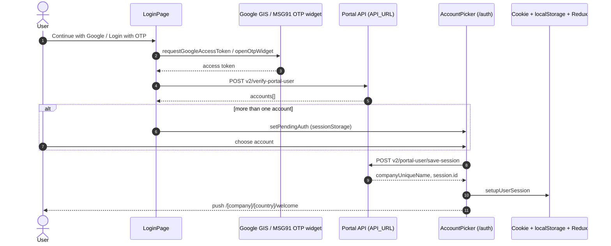
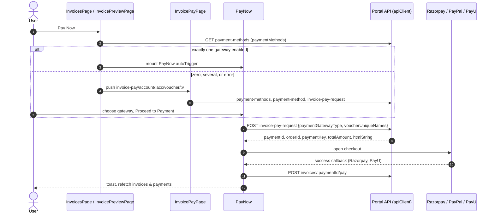

# User Flows & Critical Journeys

The end user is a customer of a business that uses Giddh. The business shares the portal with them so they can sign in, see invoices, payments and statements, and pay. (Confirmed by the owner, 2026-11-17.) Every journey below runs in the browser: all pages are client components (`"use client"`). There is no Next.js middleware. Guarding happens in components (`src/components/SessionGuard.tsx:SessionGuard`) and in the Axios interceptor (`src/lib/apiClient.ts:ApiClient`).

Endpoint payloads, headers and storage keys belong to [CONTRACTS.md](CONTRACTS.md). The route tree, providers and Redux store belong to [ARCHITECTURE.md](ARCHITECTURE.md). This file names endpoints by their builder (`API_PATHS.*`, `PROXY_API_PATHS.*`, `GIDDH_MAGIC_LINK_PATHS.*` in `src/constants/apiPaths.ts`).

## Core User Journeys Map

| Flow Name | Trigger / Starting Route | Target Outcome | Primary Route & Component |
|---|---|---|---|
| 1. App load & white-label config | Any URL | Branded config in context; API base picked (IN/UK) | `src/contexts/ConfigContext.tsx:ConfigProvider` |
| 2. Login (Google / OTP / proxy token) | `/[company]/[country]/login`, `/auth`, `/auth/[country]` | `<company>-session` cookie set, user on `/welcome` | `src/app/[company]/[country]/login/page.tsx:LoginPage` |
| 3. Account switching | Header dropdown on welcome, invoice, payment, statement, details | New session for the chosen account, page reloads | `src/components/SwitchAccountButton.tsx:SwitchAccountButton` |
| 4. Invoices → preview → pay | `/[company]/[country]/invoice` | Gateway checkout opened, then lists refreshed | `src/components/PayNow.tsx:PayNow` |
| 5. Payments & account statement | `/payment`, `/payment/preview`, `/account-statement` | Receipt PDF shown; statement exported as PDF/XLSX | `src/app/[company]/[country]/account-statement/page.tsx:AccountStatementPage` |
| 6. Magic-link ledger | `/magic?id=<linkId>` | Read-only ledger with no login | `src/app/magic/page.tsx:Magic` |
| 7. Welcome & details | `/[company]/[country]/welcome`, `/details` | Balance, last payment, profile and contacts | `src/app/[company]/[country]/welcome/page.tsx:WelcomePage` |

Entry redirects: `/` is a static landing page (`src/app/page.tsx:Home`). `/[company]/[country]` pushes to `/login` (`src/app/[company]/[country]/page.tsx:CompanyCountryRoot`). If the session cookie exists, `/login` pushes to `/welcome`. Unknown URLs render `src/app/not-found.tsx:NotFound`.

---

## Detailed Journey: 1. App load & white-label resolution

1. **Shell.** `src/app/layout.tsx:RootLayout` wraps the app in this order: `ConfigProvider` → `FaviconUpdater` + `TitleUpdater` → `ReduxProvider` → `ToastProvider` → `SessionVerification`.
2. **First paint.** The `ConfigProvider` initial state is `mergeWhiteLabelConfig(localStorage.whiteLabel)` (`src/config/default.ts:mergeWhiteLabelConfig`). On the server it is `DEFAULT_CONFIG`. Cached branding therefore shows immediately.
3. **Fetch.** On mount, `loadConfig` takes path segment 1 as the country. It calls `GET {GIDDH_API_URL_UK}/white-label` when that segment is `uk`, else `GET {GIDDH_API_URL}/white-label`. Both bases come from `DEFAULT_CONFIG`, never from the cache. If `data.body` is present, it is written to `localStorage.whiteLabel`.
4. **Skip on magic.** The fetch is skipped when the pathname is exactly `/magic` or `/magic.html`. Magic pages use whatever is cached, or the defaults.
5. **Merge.** `mergeWhiteLabelConfig` overlays these fields: `proxyUrl`, `giddhWhiteLabel.apiDomain` (feeds **both** `API_URL` and `GIDDH_API_URL`), `proxyApiUrlUk`, `proxyReferenceId(Uk)`, `websiteDomain`, top-level `brandName`/`logos`, `googleClientId` and `portalMessages.switchAccountAuthError`. `OTP_WIDGET_ID`/`OTP_WIDGET_TOKEN` always come from defaults. Any field that is missing falls back to `DEFAULT_CONFIG`, which is `PROD_CONFIG` or `NON_PROD_CONFIG` depending on the app env ([DEVELOPMENT.md](DEVELOPMENT.md)).
6. **Apply.** `src/components/FaviconUpdater.tsx:FaviconUpdater` swaps the icon links once `isLoading` is false. Components read config through `useConfig()` or `src/hooks/useAppConfig.ts:useAppConfig`. Non-React utilities call `getConfig()`, which re-reads `localStorage.whiteLabel` on every call.
7. **Per-request base.** The `src/lib/apiClient.ts:ApiClient` request interceptor sets `baseURL`. It uses `API_URL_UK` when path segment 1 is `uk`, else `API_URL`. It also adds a `Session-Id` header from cookie `<segment0>-session`. Proxy helpers in `src/utils/proxy/` and `src/utils/auth/` choose `API_URL_UK` vs `API_URL` from an explicit `country` argument.

**Branches**
- `/auth?country=uk`: path segment 1 is empty, so the IN white-label is fetched even for a UK login. `/auth/uk` gets the UK one.
- `GET /api/instance-metadata` (`src/app/api/instance-metadata/route.ts`) is **not** part of app load. Nothing in `src/` calls it. It proxies the AWS IMDSv2 identity document for every HTTP method, with a 3 s timeout (504 on timeout, 503 on failure). Exposure risk: [OPEN_QUESTIONS.md](OPEN_QUESTIONS.md).

| Failure Scenario | Where Caught | UI Feedback | Recovery / Fallback Action |
|---|---|---|---|
| `/white-label` network/JSON error | `src/contexts/ConfigContext.tsx:ConfigProvider` | None (only `error` in context) | Cached `whiteLabel`, else `DEFAULT_CONFIG` |
| Response has no `body` | same | None | Previous cache kept |
| Corrupt `localStorage.whiteLabel` | `getStoredWhiteLabel` / `getConfig` try/catch | None | `DEFAULT_CONFIG` |
| Cache from another brand on a shared browser | Not handled | Wrong logo/API base until the fetch completes | Fetch overwrites it (magic pages never refresh it) |

---

## Detailed Journey: 2. Login, session and logout

### 1. Happy Path Sequence

### 2. Step-by-Step Path & Code Connections

1. **Route.** `/[company]/[country]/login` → `src/app/[company]/[country]/login/page.tsx:LoginPage`. On mount it dispatches `setCompanyData` and calls `sessionManager.setCompanyData`, which writes `companyName`/`country` to sessionStorage. It preloads the Google SDK. If `getSessionCookie(company)` is truthy, it renders nothing and pushes `/welcome`.
2. **Google.** `ensureGoogleSdk` → `requestGoogleAccessToken(googleClientId)` (scope `openid email profile`) → `getGoogleUserEmail` (Google userinfo) → `verifyPortalUserByAccessToken(token, company, "google", country, email)`. Code: `src/utils/auth/googleIdentity.ts`, `src/utils/auth/verifyPortalUserByAccessToken.ts`.
3. **OTP.** `openOtpWidget(OTP_WIDGET_ID, OTP_WIDGET_TOKEN)` loads the MSG91 otp-provider script. The widget's `success` payload `message` is the access token. It is then sent to `verifyPortalUserByAccessToken(..., "otp", country)`, which sends `otpAccessToken` instead of `accessToken` (`src/utils/auth/msg91OtpWidget.ts`).
4. **Verify.** `PROXY_API_PATHS.VERIFY_PORTAL_USER` on `API_URL` or `API_URL_UK`, with `subDomain` = the `[company]` slug. A success response with a non-empty `body` is a list of `{ account, vendorContactUniqueName, email, companyUniqueName }`. See [CONTRACTS.md](CONTRACTS.md).
5. **Single account.** `handleVerifiedAccounts` stores `accessToken`, `authProvider` and `proxy_auth_token` (same token) in localStorage. It then calls `savePortalSession` (`src/utils/proxy/saveSession.ts:savePortalSession`). For OTP the token is **not** sent to save-session. For Google it is sent as `accessToken`.
6. **Several accounts.** `sessionManager.setPendingAuth(accounts, token, email, "accessToken")` → push `/[company]/[country]/auth` (`src/app/[company]/[country]/auth/page.tsx:AuthPage`). The picker reads the pending auth; without it, it pushes back to `/login`. When the user picks an account, it calls `savePortalSession`, passing the token as `proxyAuthToken` (tokenType `proxy`) or as `accessToken` (tokenType `accessToken`, provider from `localStorage.authProvider`). Then it calls `clearPendingAuth`.
7. **Persist.** `src/utils/auth/setupUserSession.ts:setupUserSession` sets cookie `<company>-session` = `session.id` (7 days, `path=/`). It dispatches `setUserData` + `setAccount`, writes `userEmail:<company>` and `userData:<company>`, and deletes the legacy `userData`/`userEmail` keys. After a 100 ms delay (`TIMING.REDIRECT_DELAY`) it pushes `/welcome`.
8. **Hydrate.** `src/app/[company]/[country]/layout.tsx:CompanyLayout` sees the cookie. It dispatches `fetchCompanyDetails` and `fetchUserDetails` once per company + account (`API_PATHS.companyDetails`, `accountDetails`, `contacts`).

### 3. Alternative Paths & Conditional Branches

- **Proxy-token entry (`/auth?proxy_auth_token=…&company=…&country=…`)** → `src/app/auth/page.tsx:Auth`. It waits for config, then:
  1. `getDetails(token)`: `PROXY_API_PATHS.GET_DETAILS` on `PROXY_URL`, with header `proxy_auth_token`.
  2. `verifyPortalUser(email, company, token, country)`.
  3. Then the same single/multi-account split as above, with tokenType `proxy`.

  If `company`/`country` are missing from the query, it falls back to the sessionStorage values. A malformed URL that contains a nested `/auth?` is rewritten to a clean `/auth?…`.
- **`/auth/[country]?proxy_auth_token=…`** → `src/app/auth/[country]/page.tsx:AuthWithCountry`. Same flow, except the country comes from the path and the company comes from `?company` or sessionStorage. This is where the MSG91 proxy-auth widget sends guests from the preview pages (Journey 4), using `getAuthRedirectPath(country)`, which gives `/auth/uk` or else `/auth/in`.
- **A token lands on a guest page.** `invoice/preview`, `payment/preview` and `invoice-pay` call `router.replace('/auth?proxy_auth_token=…&company=…&country=…')` when `?proxy_auth_token` is present.
- After a proxy-token or picker login, the user always lands on `/welcome`, never back on the invoice they came from.

### 4. Permissions, Roles & Guard Rails

- **Required:** cookie `<company>-session` for any non-public `[company]/[country]` route. There are no roles. What the user can see is decided server-side per `companyUniqueName` + `accountUniqueName`.
- **Route guard:** `src/components/SessionGuard.tsx:SessionGuard` (inside `CompanyLayout`). Public substrings are `/auth`, `/login`, `/invoice/preview`, `/payment/preview` and `/invoice-pay`. On any other route without the cookie, it pushes `/[company]/[country]/login`. It checks **only that the cookie exists**, not that it is valid.
- **Expired session:** the response interceptor in `src/lib/apiClient.ts` turns 401/403 into a `session-expired` window event. `src/components/SessionVerification.tsx` then opens `src/components/SessionExpiredModal.tsx`; **Re-login** deletes this company's cookie and pushes `/login` (or `/auth` when outside `[company]`). The event is suppressed on the public routes above **and whenever `localStorage.proxy_auth_token` exists**. Every successful login sets that key and logout does not clear it, so after a first login the modal effectively never appears. Treat this as a known gap, not intended behaviour.
- **Logout:** Sidebar → `logoutCompany(company)` (`src/utils/logout.ts`) deletes the cookie, `userData:<company>` and `userEmail:<company>`. Then it dispatches `clearCompanyData` and pushes `/login`. `proxy_auth_token`, `accessToken`, `authProvider` and `whiteLabel` stay. Other companies' sessions are untouched, because sessions are per slug.

### 5. Failure Modes & Recovery Paths

| Failure Scenario | Where Caught | UI Feedback | Recovery / Fallback Action |
|---|---|---|---|
| Google/OTP not configured | `LoginPage` handlers | Inline `ErrorMessage` | Fix white-label `googleClientId` / defaults |
| Google SDK or OTP script fails to load | `ensureGoogleSdk` / `ensureOtpProviderScript` rejects | Inline error | Retry the button (the script promise is cached, so reload the page) |
| No Google email | `LoginPage:handleGoogleLogin` | "Unable to fetch your Google email" | Retry |
| verify-portal-user `error`/empty | `LoginPage`, `Auth`, `AuthWithCountry` | Inline error (login) or toast + push `/login` (auth) | User is not a portal contact for this subdomain |
| save-session fails | `LoginPage`, `AuthPage`, `Auth` | Inline error / toast | Retry picker; `/auth` sends back to `/login` |
| `/auth` with token but no company anywhere | `Auth` effect guard | Spinner forever | Open with `?company=`. [!TODO] confirm whether upstream links always include it |
| No pending auth on `/[company]/[country]/auth` | `AuthPage` effect | Redirect | Push `/login` |
| Session expired server-side | `apiClient` interceptor | Modal (only if no `proxy_auth_token`) | Re-login; otherwise pages show their own error states, so log out manually |

---

## Detailed Journey: 3. Account switching

1. **Trigger.** `SwitchAccountButton` is rendered in the header of welcome, invoice, payment, account-statement and details. It hides itself when exactly one account is cached.
2. **List.** On mount, once an email is known (`userEmail:<company>` or the first contact email from `userDetails`), it dispatches `fetchVendorsList` → `API_PATHS.vendorsList` with `?emailId=`. The result is cached in a module-level `accountsCache[company]` until a switch or a full reload.
3. **Select.** It needs `localStorage.proxy_auth_token` and an email, otherwise it shows `SWITCH_ACCOUNT_AUTH_ERROR_MESSAGE` (white-label `portalMessages.switchAccountAuthError` or the default copy). It calls `savePortalSession(account, vendorContactUniqueName, proxyToken, company, country)`, which always sends the token as `proxyAuthToken`, including after a Google/OTP login where that key holds the IdP access token.
4. **Apply.** `setupUserSession` → `clearCompanyData(company)` → drop `accountsCache[company]` → 100 ms → `window.location.reload()`. The reload re-runs Journey 1 and the layout hydration with the new account.
5. **Guard.** The current account's option is disabled ("Current").

| Failure Scenario | Where Caught | UI Feedback | Recovery / Fallback Action |
|---|---|---|---|
| Missing token/email/company | `fetchAccounts` / `handleAccountSelect` | Configured auth-error message | Log in again |
| Timeout (`ECONNABORTED`) | same | "Request timed out…" | Retry |
| 401/403 | same | "Session expired. Please log in again." | Log out and log in |
| Empty list | `fetchAccounts` | "No accounts found." | Nothing to switch to |

---

## Detailed Journey: 4. Invoices → preview → pay

### 1. Happy Path Sequence

### 2. Step-by-Step Path & Code Connections

1. **List.** `src/app/[company]/[country]/invoice/page.tsx:InvoicesPage` dispatches `fetchAllInvoices`, which calls `getInvoiceList` → `POST API_PATHS.vouchersGetAll` with type `sales`. State is keyed per company in Redux. The page de-duplicates its own requests with `lastKeyRef`, and the thunk skips work through its `condition` (same sort/status/page/account → no refetch). The status filter maps to `balanceStatus` (`PAID`, `PARTIAL-PAID`, `UNPAID`, `HOLD`, `CANCEL`). Rows with any other status are dropped. **Pay Now** shows only for `UNPAID`/`PARTIAL-PAID`. **Download PDF** calls `downloadInvoice` (`API_PATHS.downloadFileBase`, base64) and then `downloadBase64AsPDF`.
2. **Preview.** The invoice number pushes `/invoice/preview?voucher=…&companyUniqueName=…&accountUniqueName=…` → `src/app/[company]/[country]/invoice/preview/page.tsx:InvoicePreviewPage`. In parallel it calls `getVoucherDetails` (`POST API_PATHS.invoicePayRequest`, body = voucher array) and `getInvoiceComments`. The PDF comes from `vouchers[0].content` (base64 → blob URL in an iframe). Print, Download (`API_PATHS.downloadFile`) and **Add Comment** (`API_PATHS.voucherAddComment`) are also here. Comments need a session; a failure shows "Login required to add comments". **Pay Now** is shown when `voucher.canPay`.
3. **Pick the path.** In both list and preview, `handlePayNowClick` calls `getPaymentMethods` (`src/utils/payment.ts`). If exactly one of RAZORPAY/PAYPAL/PAYU is enabled (accepting `true` or `{enabled !== false}`, any case), it mounts `<PayNow autoTrigger>`. Otherwise, or on error, it pushes the invoice-pay route.
4. **Invoice-pay page.** `/[company]/[country]/invoice-pay/account/[accountUniqueName]/voucher/[voucherUniqueName]` → `src/app/[company]/[country]/invoice-pay/account/[accountUniqueName]/voucher/[voucherUniqueName]/page.tsx:InvoicePayPage`. The `[...slug]` route re-exports the same page and reads `slug = ["account", acc, "voucher", v]`. The voucher segment may hold several names joined by `|` ("Payment All Invoices"). The company comes from `?companyUniqueName`, else Redux/localStorage. The page then:
   - calls `getPaymentMethods`, which pre-selects Razorpay, then PayPal, then PayU;
   - then calls `getInvoicePayVoucherDetails`;
   - calls `getPaymentMethodList` (`API_PATHS.paymentMethodList`) in parallel, only for the radio list.
   If no vouchers come back, it `replace`s to `/invoice`.
5. **Initialise.** `src/components/PayNow.tsx:PayNow` → `processPayment` → `getVoucherPaymentDetails`, which is `POST API_PATHS.invoicePayRequest` with `{paymentGatewayType, voucherUniqueNames}`. For PayU it also sends `name`, `email` and `contactNo`. Then it calls `initializePaymentGateway`.
6. **Gateways.**
   | Gateway | Needs from `invoice-pay-request` | Opens | Success handling | Cancel / failure |
   |---|---|---|---|---|
   | Razorpay | `paymentKey`, `orderId`, `totalAmount`, `currency.code`, `company.name`; Razorpay checkout script loaded on mount | Razorpay modal | `handler` → `updatePaymentStatus` (`API_PATHS.invoicePay`) with `razorPayPaymentId`, `totalAmount`, `date` | `ondismiss` → `onAutoTriggerDone`; a failed update is only logged |
   | PayPal | `paymentKey` (business email), `totalAmount`, `currency.code`, `vouchers[0].number` | Hidden form POST to `https://www.paypal.com/cgi-bin/webscr` (full-page redirect) <!-- verify:ignore --> | Returns to the same URL plus `payment_id=<paymentId>`. On invoice-pay, a `PayerID` query param shows "Invoice payment is being processed." No client call to `invoicePay` | `cancel_return` = the current URL |
   | PayU | User's name, email, 10-digit phone (form in a modal: `portalDetails` is never written, so the form always shows); response `htmlString` | `htmlString` as a blob in a popup window | Any `message` event with truthy `data.status` → `updatePaymentStatus` with `PAYU`, then the popup closes | Closing the popup does nothing; the button is re-enabled |
7. **After success.** `PayNow` shows a toast with the server body or "Payment successful!". It dispatches `invalidatePaymentsData` + `invalidateInvoicesData`, refetches payments, invoices and the unpaid-invoices view (ignoring `ConditionError`), and calls `onSuccess`. On invoice-pay, `onInvoicePaySuccess` optimistically marks the voucher "being processed" and reloads the voucher details. A `PAID` voucher shows "<numbers> is/are successfully paid."

### 3. Alternative Paths & Conditional Branches

- **Guest (public link) access.** `invoice/preview`, `payment/preview` and `invoice-pay` are public in `SessionGuard`, in the interceptor and in the layout (no footer and no sidebar user block without a session). With no cookie, the page mounts the MSG91 proxy-auth widget: `AuthHeader`, MSG91 proxy-auth script, `initVerification({ referenceId, addInfo.redirect_path })`. It stores `companyName`/`country` in sessionStorage for `/auth/[country]`. API calls go out without `Session-Id`. Whether a guest can read or pay depends on the backend ([OPEN_QUESTIONS.md](OPEN_QUESTIONS.md)).
- **Public link shape.** `/[company]/[country]/invoice-pay/account/<accountUniqueName>/voucher/<voucherUniqueName>?companyUniqueName=<company>` needs no stored state. Without `companyUniqueName`, a guest gets nothing and is redirected to `/invoice`, which then pushes them to `/login`.
- **Wrong environment.** The PayPal URL is hard-coded to live PayPal. `PAYPAL_URL` (sandbox in non-prod) is never read.

### 4. Permissions, Roles & Guard Rails

- `canPay` comes from the server per voucher, and the UI hides Pay Now for statuses that cannot be paid. The real check is server-side in `invoice-pay-request`.
- `PayNow` resolves company/account from props (public pages) first, then Redux, then `userData:<company>`. If none resolves, it shows the toast "Missing company or account information".
- Several pages pass `sessionId` from `localStorage.token`, which nothing writes. The real `Session-Id` comes from the cookie through the interceptor.

### 5. Failure Modes & Recovery Paths

| Failure Scenario | Where Caught | UI Feedback | Recovery / Fallback Action |
|---|---|---|---|
| No gateway enabled | `PayNow:loadPaymentMethods`, `InvoicePayPage:loadPaymentMethods` | Toast "No payment methods…" / "No payment method is integrated" | Business enables a gateway in Giddh |
| payment-methods call fails on list/preview | `handlePayNowClick` catch | None | Falls through to the invoice-pay page |
| invoice-pay-request fails | `PayNow:processPayment` | Toast with the API message | Retry |
| Razorpay SDK missing / no `paymentKey` | `initializeRazorpay` | Toast | Reload; contact support |
| 403 on voucher details | `InvoicePayPage:loadVoucherDetails` | "Access denied. Your session may have expired…" | Sign in through the widget |
| Payment captured but `invoicePay` fails | `handleRazorpaySuccess` catch | None (only logged) | [!TODO] confirm whether a server webhook reconciles this |
| PayU popup blocked | `window.open` returns null | Nothing happens | Allow popups and retry |

---

## Detailed Journey: 5. Payments and account statement

1. **Payments list.** `src/app/[company]/[country]/payment/page.tsx:PaymentsPage` → `fetchAllPayments` → `getLastPayment` → `POST API_PATHS.vouchersGetAll` with type `receipt`. Sort is by Date (desc) or Amount, with server pagination (`PAGINATION_LIMIT`). The columns show the payment number, date, amount, mode and unused amount (`balanceDue`). Clicking the payment number pushes `/payment/preview?voucher=…&companyUniqueName=…&accountUniqueName=…`.
2. **Payment preview.** `src/app/[company]/[country]/payment/preview/page.tsx:PaymentPreviewPage` → `downloadPaymentVoucher` (`src/utils/paymentPreview.ts`, `API_PATHS.downloadFile`) → base64 → iframe. Download re-calls the same endpoint and saves `payment-<voucher>.pdf`. Print uses the iframe. The page is public, with the same guest widget as Journey 4. On the welcome page, `LastPaymentCard` links to both previews.
3. **Account statement.** `src/app/[company]/[country]/account-statement/page.tsx:AccountStatementPage`. The range defaults to the current calendar month, and the API takes dates as `dd-MM-yyyy` (`convertDateToAPIFormat`). Changing from/to (`src/components/ui/DateRangeCalendar.tsx`), page or date sort refetches `getAccountStatement` (`API_PATHS.viewStatement`). The page renders the account and company addresses, the summary (opening, debit, credit, closing) and the transactions. Debits appear under Amount, credits under Payments, with a running balance.
4. **Export.** "As PDF" / "As XLSX" → `downloadAccountStatement(request, format)` (`API_PATHS.exportAccountStatement`, with `fileType`). The request sends the **current page and count**; whether the server exports the full range is not confirmed (see [OPEN_QUESTIONS.md](OPEN_QUESTIONS.md)). The client requires `body.data` (base64) and a `body.type` that matches the expected extension or MIME (`EXPORT_FILE_CONFIG`). It names the file `body.name` or `Account-statement-<from>-<to>.<ext>`.

| Failure Scenario | Where Caught | UI Feedback | Recovery / Fallback Action |
|---|---|---|---|
| Missing company/account | `fetchAccountStatement` | "Missing company or account information" | Log in again |
| Statement API error | same | "Failed to load account statement" | Change range or reload |
| Export with no content / wrong type | `handleExport` | Specific toast ("No file content…", "invalid file type…") | Retry; backend issue |
| Payment voucher PDF fails | `loadPaymentData` | Toast with the API message | Back to `/payment` |

---

## Detailed Journey: 6. Magic-link ledger (no login)

1. **Route.** `/magic?id=<linkId>` → `src/app/magic/page.tsx:Magic`. It sits outside `[company]/[country]`, so there is no `SessionGuard`, sidebar or session. `ReduxProvider` renders no loading screen here. White-label is not fetched (Journey 1).
2. **Load.** `getMagicLinkData` (`src/utils/magic/getMagicLinkData.ts`) → `getMagicLinkLedger`, which is plain `axios` to `{GIDDH_API_URL}` + `GIDDH_MAGIC_LINK_PATHS.ledger`. Query params are `sort`, `ledgerView`, `from`, `to`, `page`/`token`+`reversePage`, `count`, `q` and `accountCurrency`. It always uses the IN/white-label `GIDDH_API_URL`, never the UK base. Then `getMagicLinkLedgerBalance` (`GIDDH_MAGIC_LINK_PATHS.ledgerBalance`) loads the footer totals.
3. **First response decides.** The date range (when the API returns `dateRange`), the view (the API's `ledgerView`, or inferred from which transaction arrays are non-empty: `STATEMENT_VIEW` vs `T_VIEW`) and the currency toggle (shown only when transaction and converted currency differ; `accountCurrency` picks the default).
4. **Interact.** Changing dates, view, page size, page token, currency or search (debounced 500 ms, sent as `q`) refetches. Results are also filtered client-side on particular and amount. Rows can download a voucher or an attachment (`src/utils/magic/downloadVoucher.ts:downloadMagicLinkVoucher`, `downloadMagicLinkAttachment`, called from `StatementViewTable` and `TAccountViewTable`). Print uses `window.print()`.
5. **Failures.** A missing `id` shows "A valid link ID is required…". An API failure or `status !== success` shows `result.error` or "Failed to load ledger data", and all ledger state is cleared. No retry button exists; reload the page.

---

## Detailed Journey: 7. Welcome and details

- **Welcome** (`src/app/[company]/[country]/welcome/page.tsx:WelcomePage`) dispatches `fetchBalanceSummary` (`API_PATHS.vouchersBalanceSummary`) and `fetchAllPayments` (latest first, `refetch: true`). It renders `BalanceSummaryCard`, `LastPaymentCard` and `UserDetailsCard`. The IDs come from Redux, else `userData:<company>`.
- **Details** (`src/app/[company]/[country]/details/page.tsx:DetailsPage`) is opened from the sidebar avatar. It reads `userDetails` (account details + contacts) that the layout already loaded, and makes no call of its own. Back = `router.back()`.
- **Navigation:** the sidebar (`src/components/Sidebar.tsx:Sidebar`) links Home, Invoices, Payments Made and Account Statement, plus avatar → Details and Logout.

## Superseded docs

This file replaces the journey content of `docs/White-Label-Flow.md` and `docs/ROUTING.md`. These claims in them no longer match the code:
- `FALLBACK_CONFIG` does not exist <!-- verify:ignore -->; `DEFAULT_CONFIG` is the fallback.
- `API_URL` comes from `giddhWhiteLabel.apiDomain`, not `proxyApiUrl` (commit a244645, "Removed msg91 proxy from Login").
- `BRAND_NAME`/`LOGOS` come from the top-level `brandName`/`logos`, not from `giddhWhiteLabel`.
- `/[company]/[country]` redirects to `/login`, not `/welcome`.
- The list routes are `/invoice` and `/payment`, not `/invoices` and `/payments`. <!-- verify:ignore -->
- There is no `?redirect=` after login.
- Only `uk` changes behaviour; every other country uses the IN bases.
